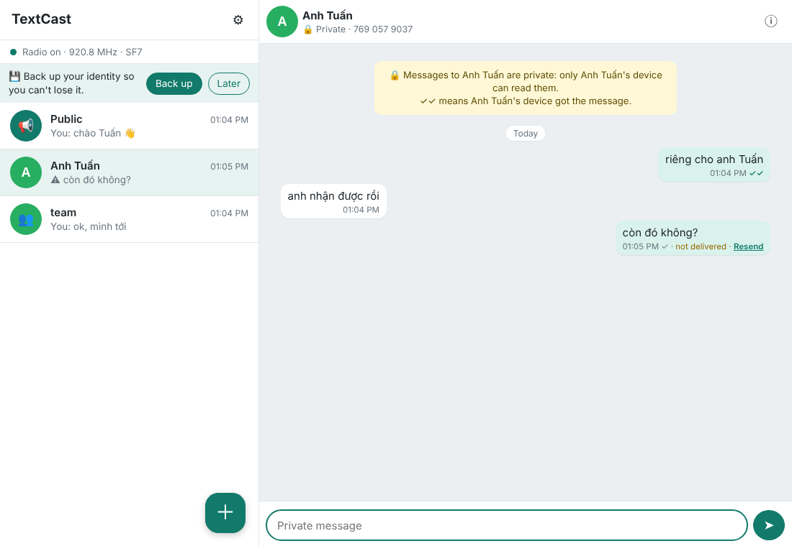
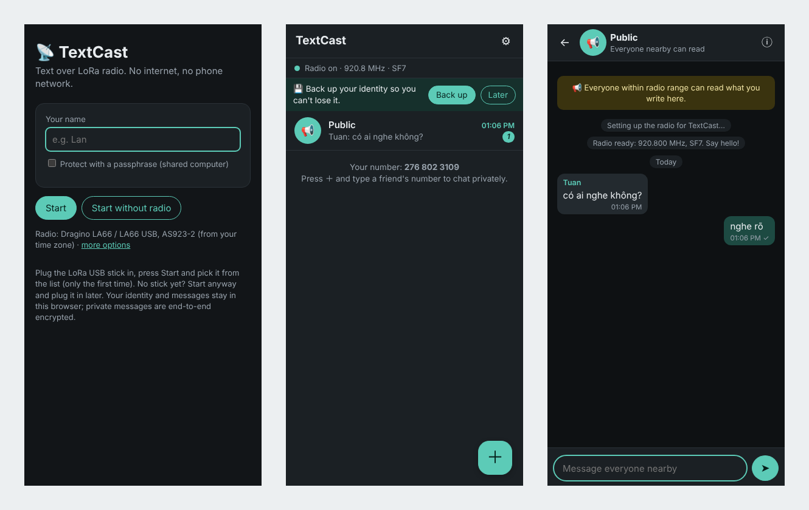
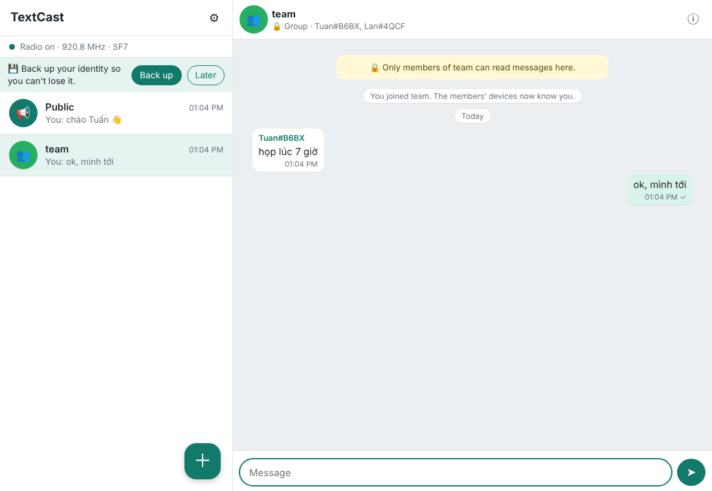
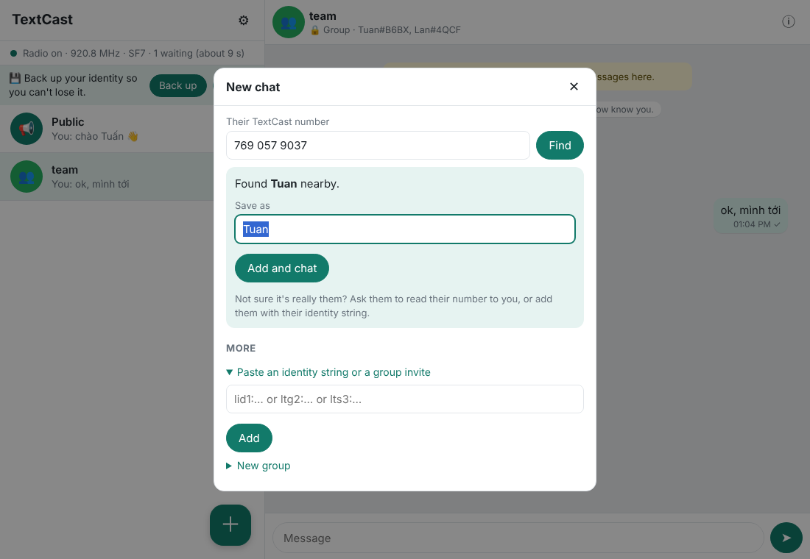
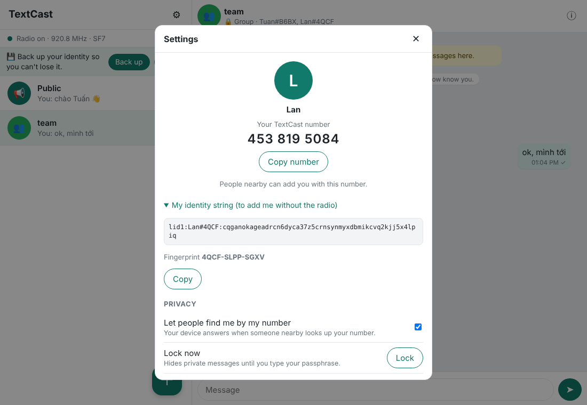

# TextCast

**A text walkie-talkie over LoRa radio. No internet, no server, no SIM card.**

TextCast turns cheap LoRa radio modules into a **text network** that phones and
laptops share. Plug a module into a computer or an Android phone and you can
chat with everyone in range, kilometres away, with nothing in between: no cell
tower, no Wi-Fi, no account, no company.

```
   📱 Android + LoRa stick              💻 laptop + LoRa stick (browser)
          │                                     │
          ╰──────────  one shared LoRa channel  ╯   ← 1–3 km in a city,
          ╭──────────  (920.8 MHz, 125 kHz)     ╮     more in open terrain
          │                                     │
   💻 laptop + LoRa stick (terminal)   📱 Android + LoRa stick
```

It works like the messenger on your phone: a **Public** chat that everyone in
range reads, **private chats** with one person (✓✓ when it was delivered), and
**groups**. People find each other by a **10-digit TextCast number**, without
any server handing numbers out.

<p align="center"></p>

> **Built with AI.** This project was designed and written with substantial help
> from an AI assistant (Claude, by Anthropic). A human directed the work and
> tested it on real hardware. The code, including the cryptography, has **not**
> been independently reviewed or audited. Read it before you rely on it.

**Status:** working prototype (v0.7). Tested with Dragino LA66 USB sticks on
laptops (browser and terminal app) and Android phones. Not field-tested at
scale.

## Start here

You need a **LoRa USB stick** for each device: the Dragino **LA66 USB** with
the **P2P firmware v1.2.4** is tested (see [Hardware](#hardware)). Then pick
the way that suits you:

| You have | Use | Install |
|---|---|---|
| A computer (Windows, macOS, Linux, Chromebook) | 🌐 **[The web app](https://tnnotes.github.io/textcast/)** | nothing |
| An Android phone or tablet | 📱 **The Android app** | one APK file |
| A computer, and you like the terminal or want to change the code | 💻 **The repository** (Python) | Python 3.10+ |

All three speak exactly the same protocol, so they chat together, and one
encrypted identity file (`.ltid`) moves between them.

### 🌐 In your browser: easiest

1. Open **https://tnnotes.github.io/textcast/** in **Chrome**, **Edge** or
   **Firefox** (151 or newer).
2. Type your name and press **Start**.
3. Plug the LoRa stick in and pick it from the list the browser shows (only
   the first time). No stick yet? Start anyway and plug it in later.

That's it. After the first visit it also works **with no internet at all**,
and Chrome and Edge can **install** it as an app with its own icon. The region
is picked from your time zone; check it under *more options*.

<p align="center"></p>

No internet even for the first visit? Download
[`web/index.html`](web/index.html) (the download button on that page; it is the
whole app in one file), copy it to the computer and open it in the browser.
Not for Safari or iPhone/iPad (they can't talk to USB radios).
Guide: [docs/WEB.md](docs/WEB.md).

### 📱 Android

1. Download the latest **`TextCast-<version>.apk`** from the
   [Releases page](https://github.com/tnnotes/textcast/releases) and open it on
   the phone (allow "install unknown apps" when asked).
2. Create an identity and press **Start**. Choose *Connect later* if the module
   isn't plugged in yet.
3. Plug the LoRa stick into the phone with a **USB OTG** adapter, any time.
   TextCast connects by itself (allow USB access when Android asks).

Needs Android 5.0 or newer with USB host (OTG) support. Guide:
[docs/ANDROID.md](docs/ANDROID.md).

### 💻 Advanced: run it from the repository

Everything is in this repository: the terminal app, the Python core library,
the web app's source, the Android project and the tests. Run the terminal app
(macOS, Windows, Linux, Raspberry Pi) with **Python 3.10+**:

```bash
git clone https://github.com/tnnotes/textcast.git
cd textcast
python3 -m pip install -r requirements.txt     # pyserial, textual (qrcode optional)
python3 chat.py
```

The login panel asks for an identity and a passphrase; leave the radio on
**Automatic** and plug the stick in whenever you like. Then it works like the
other apps: chats on the left, the open chat on the right. **Ctrl+N** starts a
new chat, **F2** opens settings, **F1** help. On Windows use `py` instead of
`python3`, and Windows Terminal. Guide: [docs/USER_GUIDE.md](docs/USER_GUIDE.md).

Other tools in the repository:

```bash
python3 identity.py --help    # back up, restore, move an identity; change the passphrase
python3 settings.py --help    # radio module, region / radio profile, log limits
python3 fieldtest.py --help   # range and packet-loss tests between two laptops
```

Build the web app from its source, and run the tests (no radio needed):

```bash
python3 web/build.py                       # builds web/index.html from web/src/
cd web && python3 -m http.server 8000      # then open http://localhost:8000
python3 -m unittest discover -s tests      # Python: protocol, crypto, keys, simulated radios
node --test web/tests/*.test.js                     # web core: byte for byte with Python
```

The Android app is built with Android Studio: see
[docs/RELEASING.md](docs/RELEASING.md).

**All nodes must use the same radio settings** (default: AS923-2, 920.8 MHz,
SF7, 125 kHz). Region presets are starting points, **not legal advice**: check
your local rules for frequency, power, duty cycle and listen-before-talk.

## How it works

### Chats, like on your phone

<p align="center"></p>

- **📢 Public** is always at the top: plain text that everyone in range reads,
  like CB radio. Don't write anything private there.
- **People** and **groups** follow, newest first, with the last message and an
  unread count. Your messages are on the right with 🕓 waiting → ✓ sent →
  **✓✓ delivered** (private chats).
- **Groups** are encrypted end to end: only members can read them. Start one
  with **＋ → New group** and send the invite string to the members.

### TextCast numbers: find people without a server

<p align="center"></p>

Every identity has a number like **512 384 9076** (shown in ⚙ Settings).
Nobody hands numbers out: the number is computed from the identity's public
key (a slow hash plus a check digit), so you can't choose one and nobody can
take yours on purpose.

1. Lan types Tuan's number into **＋ New chat**.
2. Her app asks over the radio "who has 512 384 9076?" (7 bytes).
3. Tuan's app answers with his name and public key.
4. Lan's app checks that the key really produces that number, and saves Tuan.
   Both add each other, and they can write privately.

A typo is caught by the check digit before anything is sent. If two different
devices answer for one number, the app warns and adds no one. People who'd
rather not be found switch "Let people find me by my number" off and share
their **identity string** (`lid1:…`) instead, which also marks the contact as
verified.

<p align="center"></p>

### Private messages with delivery receipts

- A private message is encrypted for one person with a key that only the two
  of you can compute (from your Ed25519 identity keys).
- Their device confirms it automatically: **✓✓**. No confirmation within 30 s
  shows **not delivered · Resend** (out of range, switched off, or they
  haven't added you yet). A resent message is never shown twice.
- On air it looks like any other encrypted packet: nobody else can tell who is
  talking to whom.

### Plug the radio in any time

You can log in without the radio, read your chats and set things up. Plug the
stick in when you want to send: TextCast finds it and connects. Unplug it and
plug it back in, even into another USB socket: it reconnects by itself. Nothing
is received while it is unplugged.

## Why TextCast

**🛰 Works where nothing else does.** No infrastructure at all. Two people
with an inexpensive LoRa stick can exchange messages over kilometres: during
power or network outages, in rural areas, at events where the cell network
collapses, on campuses and on outdoor trips.

**🔌 Plug in and talk.** Open a web page, type your name, press Start. No app
store, no account, no setup questions: the region comes from your time zone
and the app remembers your radio.

**📱💻 Every device on one network.** The web app, the Android app and the
terminal app speak exactly the same protocol. Automated tests check that the
Python, Kotlin and JavaScript implementations produce **identical bytes** in
both directions. Your identity moves between devices as one encrypted file.

**🔒 Private by design.**
- **Private chats and groups** are encrypted (ChaCha20 + HMAC); only the
  people in them can read them.
- **No sender ID on air:** each private packet carries a short tag that changes
  every time and means something only to key holders. An outsider cannot even
  tell which chat a message belongs to.
- **Signed identities:** Ed25519 keys, handles like `Tuan#K7QX`, a TextCast
  number, fingerprints you compare in person, signed invitation strings that
  cannot be forged.
- **Locked at rest:** the identity and the private parts of the message history
  are encrypted with your passphrase (scrypt). Lock the app and the keys leave
  memory.

**🔌 Works with many LoRa modules.** Modules differ in their AT commands, so
TextCast uses **hardware profiles**. Dragino LA66 is tested; RAK3172 and Seeed
Wio-E5 profiles are included; any module that can send raw LoRa packets can be
added with a small JSON file.

**📡 A good neighbour on the air.** One channel is shared by everyone, so every
node follows the same airtime rules: a rate limit, random back-off, a
duty-cycle cap (kept when the radio is unplugged and plugged back in) and the
regional dwell-time limit. Region presets cover AS923, EU868, US915, AU915,
IN865 and KR920, and every radio parameter can be set by hand.

**🎓 Built to learn from.** Readable code in three languages, a written air
specification ([docs/SPEC.md](docs/SPEC.md)), and test suites that run without
hardware against simulated radios. A good base for teaching LoRa, embedded
radio, applied cryptography or decentralized systems.

## What it does

| Feature | How |
|---|---|
| Public chat | Plain text that anyone in range can read, like CB radio |
| Private chats | One-to-one, end-to-end encrypted, ✓✓ delivery receipts, resend |
| TextCast numbers | A 10-digit number per identity; add people by number over the air |
| Groups | One shared group key; members announce themselves automatically |
| Broadcast channels | You post; people with the signed string read and verify |
| Identities | Ed25519 key pair, handle `nick#TAG`, contacts (verified or added by number) |
| Local security | Passphrase-protected identity, lock/unlock, encrypted private history |
| Move identities | One encrypted `.ltid` file works in the browser, on laptops and on phones |
| Radio | Plug in any time, reconnects by itself; region presets or every parameter by hand |
| Radio modules | Built-in profiles (LA66, RAK3172, Wio-E5) or your own JSON profile |
| Apps | Web app (offline, installable); Android app; terminal app for macOS, Windows, Linux |

## Hardware

| Module | Status | Notes |
|---|---|---|
| Dragino **LA66 USB** with LA66 **P2P firmware v1.2.4** | tested | the stock LoRaWAN firmware does not work: flash the P2P firmware |
| RAKwireless RAK3172 / RAK3272 / RAK3372 (RUI3) | profile included, untested | |
| Seeed Wio-E5 / LoRa-E5 (factory AT firmware) | profile included, untested | |
| Any module with raw LoRa P2P over AT commands | your JSON profile (terminal app) | please share profiles that work |

Use the module variant made for your band (868 MHz or 915/923 MHz). Phones need
USB host (OTG) support; iPhones cannot use USB-serial modules. On Windows, a
stick that doesn't show up needs the driver for its USB chip. Setup, firmware
notes and custom profiles: [docs/HARDWARE.md](docs/HARDWARE.md).

<p align="center"></p>
<p align="center"><sub>The first hardware test: two laptops and a phone with LA66 sticks on one channel (an earlier version of the apps).</sub></p>

## Capacity, honestly

- **One radio hop.** There are no repeaters or routing. Range is what the
  radios reach (SF7: roughly 1–3 km in a city, more in open terrain).
- **Shared capacity:** one channel carries about **1 message per second for
  everyone in range**.
- **Message size:** up to 100 bytes at the default profile: about 92 bytes of
  text in a private message, 93 in a group. Vietnamese and other non-Latin text
  uses 2–3 bytes per character. Slower settings (SF9, SF10) reach further but
  carry fewer bytes.
- It is not an internet replacement. See [docs/SCALING.md](docs/SCALING.md).

## Project layout

```
web/                 the web app
  index.html         the whole app in one file (built from web/src/)
  src/               the JavaScript core (crypto, protocol, keys, numbers, radio) and the page
  build.py           builds index.html, the offline worker and the manifest
  tests/             byte-for-byte tests against Python, browser test with a simulated LA66
chat.py              terminal app (Textual)
identity.py          back up, restore and move identities, change passphrase
settings.py          radio module, radio profile and log limits (config.json)
fieldtest.py         range and packet-loss test tool
lora_text/           core library (Python)
  protocol.py        frames, mode byte, airtime, rate limiter
  crypto.py          rolling tags, ChaCha20, counters
  keyring.py         identities, private chats, groups, channels, contacts
  numbers.py         TextCast numbers and "who has this number?"
  vault.py           passphrase encryption (scrypt + ChaCha20 + HMAC)
  ed25519.py         identity keys and private-chat keys (pure-Python RFC 8032)
  la66.py            Dragino LA66 P2P driver (unplug and plug back in)
  hardware.py        hardware profiles (built-in and JSON)
  atradio.py         generic AT-command driver for other modules
  node.py            radio + keys + log, used by the apps
  config.py, regions.py, session.py, storage.py
android/             Android app (Kotlin, Android 5.0+)
  app/src/main/java/io/github/textcast/core/   the same core, ported to Kotlin
  app/src/main/java/io/github/textcast/app/    screens, USB serial, background service
  compat/            cross-language test vectors (Python ⇄ Kotlin ⇄ JavaScript)
tests/               Python tests with simulated radios (no hardware needed)
docs/                specification, guides, hardware, security, scaling, releasing
pictures/            screenshots and photos for this README
```

## Documentation

- [docs/WEB.md](docs/WEB.md): the web app
- [docs/ANDROID.md](docs/ANDROID.md): the Android app
- [docs/USER_GUIDE.md](docs/USER_GUIDE.md): the terminal app
- [docs/HARDWARE.md](docs/HARDWARE.md): modules, firmware, custom profiles
- [docs/SPEC.md](docs/SPEC.md): air protocol and file formats
- [docs/SECURITY.md](docs/SECURITY.md): what is protected and what is not
- [docs/SCALING.md](docs/SCALING.md): capacity limits and larger-scale design
- [docs/RELEASING.md](docs/RELEASING.md): building the APK and publishing the web app
- [web/README.md](web/README.md): the web app's code
- [CONTRIBUTING.md](CONTRIBUTING.md) · [CHANGELOG.md](CHANGELOG.md)

## Known limitations

- Single hop; no repeaters, routing or store-and-forward. Messages sent while
  you are out of range or unplugged are not delivered later.
- Delivery receipts exist for private chats only. A public or group message
  lost to a collision is gone.
- TextCast numbers are short (10 digits). Someone with a lot of computing power
  could make a key with your number; the slow hash makes that expensive, and
  the app warns when two keys answer for one number. For high stakes, compare
  the number or fingerprint in person.
- The rate limit is enforced by this software only. A modified client can flood
  the channel, and jamming is always possible.
- Anyone holding a group key can post with it. Removing someone means creating
  a new group.
- Clocks must agree within about ±5 minutes (normal with network time sync).
- No listen-before-talk (the LA66 P2P firmware lacks it). Some regions, such as
  Japan and Korea, require it.
- The web app needs Chrome, Edge or Firefox 151+ on a computer; it keeps its
  data in the browser, so keep a `.ltid` backup.
- The RAK3172 and Wio-E5 profiles come from vendor documentation and have not
  been tested on real modules yet.

## License

MIT, see [LICENSE](LICENSE). Use of radio spectrum is your responsibility under
your local regulations.
