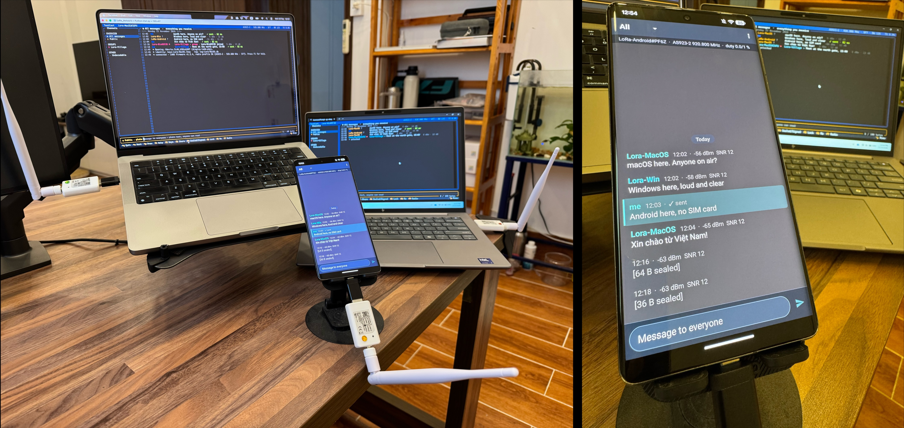
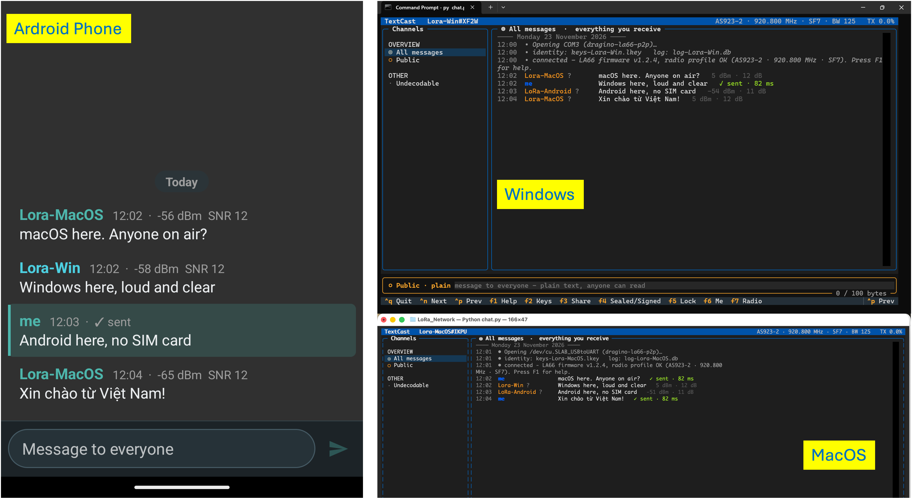
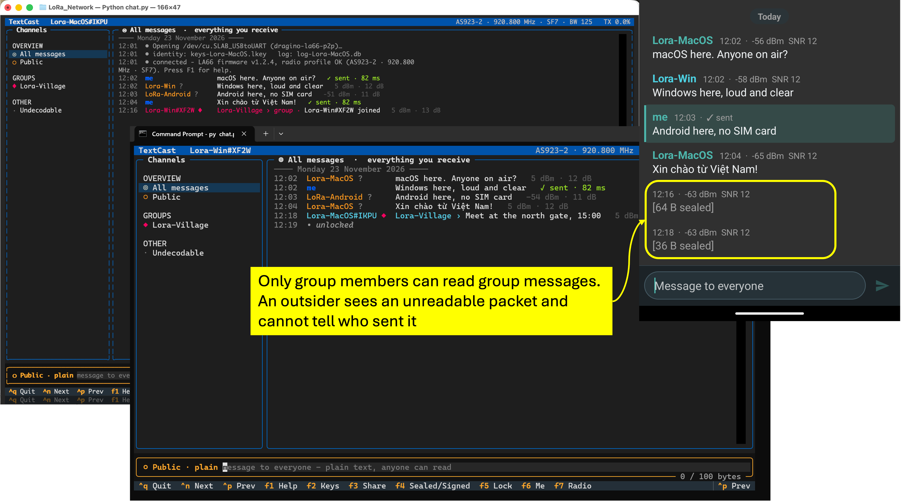
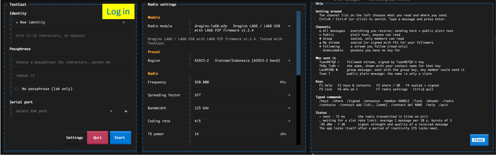

# TextCast

**Decentralized text broadcast over LoRa P2P. No internet, no server, no SIM card.**

TextCast turns cheap LoRa radio modules into a CB-radio-style **text network**
that phones and laptops share. Plug a module into a computer or an Android
phone and you can talk with everyone in range, kilometres away, with nothing in
between: no cell tower, no Wi-Fi, no account, no company.

```
   📱 Android + LoRa stick              💻 laptop + LoRa stick (browser)
          │                                     │
          ╰──────────  one shared LoRa channel  ╯   ← 1–3 km in a city,
          ╭──────────  (920.8 MHz, 125 kHz)     ╮     more in open terrain
          │                                     │
   💻 laptop + LoRa stick (Python)     📱 Android + LoRa stick
```

Everyone hears everything; **your device decides what you read**. Talk on the
public channel, follow people, or join groups that are encrypted end to end.

> **Built with AI.** This project was designed and written with substantial help
> from an AI assistant (Claude, by Anthropic). A human directed the work and
> tested it on real hardware. The code, including the cryptography, has **not**
> been independently reviewed or audited. Read it before you rely on it.

**Status:** working prototype (v0.6). Tested in a lab with Dragino LA66 USB
sticks on laptops (browser and desktop app) and Android phones. Not
field-tested at scale.

<p align="center"></p>

## Start here

You need a **LoRa USB stick** for each device: the Dragino **LA66 USB** with
the **P2P firmware v1.2.4** is tested (see [Hardware](#hardware)). Then pick
the way that suits you:

| You have | Use | Install |
|---|---|---|
| A computer (Windows, macOS, Linux, Chromebook) | 🌐 **[The web app](https://tnnotes.github.io/textcast/)** | nothing |
| An Android phone or tablet | 📱 **The Android app** | one APK file |
| A computer, and you like the terminal or want to change the code | 💻 **The repository** (Python desktop app) | Python 3.10+ |

All three speak exactly the same protocol, so they chat together, and one
encrypted identity file (`.ltid`) moves between them.

### 🌐 In your browser: easiest

1. Plug the LoRa stick into the computer.
2. Open **https://tnnotes.github.io/textcast/** in **Chrome**, **Edge** or
   **Firefox** (151 or newer).
3. Type your name and press **Start**. The first time, pick the stick from the
   list the browser shows.

That's it. After the first visit it also works **with no internet at all**,
and Chrome and Edge can **install** it as an app with its own icon. The region
is picked from your time zone; check it under *more options*.

No internet even for the first visit? Download
[`web/index.html`](web/index.html) (the download button on that page; it is the
whole app in one file), copy it to the computer and open it in the browser.

Not for Safari or iPhone/iPad (they can't talk to USB radios). Guide:
[docs/WEB.md](docs/WEB.md).

### 📱 Android

1. Download the latest **`TextCast-<version>.apk`** from the
   [Releases page](https://github.com/tnnotes/textcast/releases) and open it on
   the phone (allow "install unknown apps" when asked).
2. Plug the LoRa stick into the phone with a **USB OTG** adapter. Android
   offers to open TextCast.
3. Create an identity, choose the radio and press **Start**.

Needs Android 5.0 or newer with USB host (OTG) support. Guide:
[docs/ANDROID.md](docs/ANDROID.md).

### 💻 Advanced: run it from the repository

Everything is in this repository: the Python desktop app, the core library,
the web app's source, the Android project and the tests. Run the desktop app
(macOS, Windows, Linux, Raspberry Pi) with **Python 3.10+**:

```bash
git clone https://github.com/tnnotes/textcast.git
cd textcast
python3 -m pip install -r requirements.txt     # pyserial, textual (qrcode optional)
python3 chat.py
```

The login panel asks for an identity, a passphrase and the serial port;
**Settings** holds the radio module and radio settings. Pick a channel on the
left and type; **F1** opens help. On Windows use `py` instead of `python3`, and
Windows Terminal. Guide: [docs/USER_GUIDE.md](docs/USER_GUIDE.md).

Other tools in the repository:

```bash
python3 simple_chat.py        # the same app without Textual (curses, or --plain)
python3 identity.py --help    # back up, restore, move an identity; change the passphrase
python3 settings.py --help    # radio module, region / radio profile, log limits
python3 fieldtest.py --help   # range and packet-loss tests between two laptops
```

Run the web app from its source, and the tests (no radio needed):

```bash
python3 web/build.py                                  # builds web/index.html from web/src/
cd web && python3 -m http.server 8000                 # then open http://localhost:8000
python3 -m unittest discover -s tests                 # Python: protocol, crypto, keys, simulated radios
node --test web/tests/compat.test.js                  # web core: byte for byte with Python
```

The Android app is built with Android Studio: see
[docs/RELEASING.md](docs/RELEASING.md).

**All nodes must use the same radio settings** (default: AS923-2, 920.8 MHz,
SF7, 125 kHz). Region presets are starting points, **not legal advice**: check
your local rules for frequency, power, duty cycle and listen-before-talk.

## Why TextCast

**🛰 Works where nothing else does.** No infrastructure at all. Two people
with an inexpensive LoRa stick can exchange messages over kilometres. That
makes it useful during power or network outages, in rural areas, at events
where the cell network collapses, on campuses, and for outdoor trips.

**🔌 Plug in and talk.** Open a web page, type your name, press Start. No
app store, no account, no setup questions: the browser app picks the region
from your time zone and remembers your radio.

**📱💻 Every device on one network.** The web app, the Android app and the
desktop app speak exactly the same protocol. Automated tests check that the
Python, Kotlin and JavaScript implementations produce **identical bytes** in
both directions. Your identity moves between devices as one encrypted file.

**🔒 Private by design.**
- **Encrypted groups:** only members can read them (ChaCha20 + HMAC).
- **No sender ID on air:** each private packet carries a short tag that changes
  every time and means something only to key holders. An outsider cannot even
  tell which group a message belongs to.
- **Signed identities:** Ed25519 keys, handles like `Tuan#K7QX`, fingerprints
  you compare in person, signed invitation strings that cannot be forged.
- **Locked at rest:** the identity and the private parts of the message history
  are encrypted with your passphrase (scrypt). Lock the app and the keys leave
  memory.

**🔌 Works with many LoRa modules.** Modules differ in their AT commands, so
TextCast uses **hardware profiles**. Dragino LA66 is tested; RAK3172 and Seeed
Wio-E5 profiles are included; any module that can send raw LoRa packets can be
added with a small JSON file. Different modules on the same network talk to
each other.

**📡 A good neighbour on the air.** One channel is shared by everyone, so every
node follows the same airtime rules: a rate limit, random back-off, a
duty-cycle cap and the regional dwell-time limit. Region presets cover AS923,
EU868, US915, AU915, IN865 and KR920, and every radio parameter can be set by
hand.

**🎓 Built to learn from.** Readable code in three languages, a written air
specification ([docs/SPEC.md](docs/SPEC.md)), and test suites that run without
hardware against simulated radios. A good base for teaching LoRa, embedded
radio, applied cryptography or decentralized systems.

## What it does

| Feature | How |
|---|---|
| Public channel | Plain text that anyone in range can read, like CB radio |
| Encrypted groups | One shared group key; members announce themselves automatically |
| Follow a person | They create a *stream* and share a signed string; followers read it |
| Signed posts | Readable by everyone, verifiable by people who hold the key |
| Identities | Ed25519 key pair, handle `nick#TAG`, a contact book for verified keys |
| Local security | Passphrase-protected identity, lock/unlock, encrypted private history |
| Move identities | One encrypted `.ltid` file works in the browser, on laptops and on phones |
| Radio modules | Built-in profiles (LA66, RAK3172, Wio-E5) or your own JSON profile |
| Radio settings | Region presets or every parameter by hand; limits follow the settings |
| Apps | Web app (offline, installable); Android app; terminal app for macOS, Windows, Linux |

## Hardware

| Module | Status | Notes |
|---|---|---|
| Dragino **LA66 USB** with LA66 **P2P firmware v1.2.4** | tested | the stock LoRaWAN firmware does not work: flash the P2P firmware |
| RAKwireless RAK3172 / RAK3272 / RAK3372 (RUI3) | profile included, untested | |
| Seeed Wio-E5 / LoRa-E5 (factory AT firmware) | profile included, untested | |
| Any module with raw LoRa P2P over AT commands | your JSON profile (desktop app) | please share profiles that work |

Use the module variant made for your band (868 MHz or 915/923 MHz). Phones need
USB host (OTG) support; iPhones cannot use USB-serial modules. On Windows, a
stick that doesn't show up needs the driver for its USB chip. Setup, firmware
notes and custom profiles: [docs/HARDWARE.md](docs/HARDWARE.md).

## Capacity, honestly

- **One radio hop.** There are no repeaters or routing. Range is what the
  radios reach (SF7: roughly 1–3 km in a city, more in open terrain).
- **Shared capacity:** one channel carries about **1 message per second for
  everyone in range**.
- **Message size:** up to 100 bytes (93 bytes of text in private messages) at
  the default profile. Vietnamese and other non-Latin text uses 2–3 bytes per
  character.
- It is not an internet replacement. See [docs/SCALING.md](docs/SCALING.md).

## Project layout

```
web/                 the web app
  index.html         the whole app in one file (built from web/src/)
  src/               the JavaScript core (crypto, protocol, keys, radio) and the page
  build.py           builds index.html, the offline worker and the manifest
  tests/             byte-for-byte tests against Python, browser test with a simulated LA66
chat.py              desktop app (Textual terminal UI)
simple_chat.py       fallback desktop app without Textual
identity.py          back up, restore and move identities, change passphrase
settings.py          radio module, radio profile and log limits (config.json)
fieldtest.py         range and packet-loss test tool
lora_text/           core library (Python)
  protocol.py        frames, mode byte, airtime, rate limiter
  crypto.py          rolling tags, ChaCha20, counters
  keyring.py         identities, streams, groups, contacts
  vault.py           passphrase encryption (scrypt + ChaCha20 + HMAC)
  ed25519.py         identity keys (pure-Python RFC 8032)
  la66.py            Dragino LA66 P2P driver
  hardware.py        hardware profiles (built-in and JSON)
  atradio.py         generic AT-command driver for other modules
  node.py            radio + keys + log, used by the apps
  config.py, regions.py, session.py, storage.py
android/             Android app (Kotlin, Android 5.0+)
  app/src/main/java/io/github/textcast/core/   the same core, ported to Kotlin
  app/src/main/java/io/github/textcast/app/    screens, USB serial, background service
  compat/            cross-language test vectors (Python ⇄ Kotlin ⇄ JavaScript)
tests/               Python tests with simulated radios (no hardware needed)
docs/                specification, guides, hardware, security, scaling, releasing
```

## Documentation

- [docs/WEB.md](docs/WEB.md): the web app
- [docs/ANDROID.md](docs/ANDROID.md): the Android app
- [docs/USER_GUIDE.md](docs/USER_GUIDE.md): the desktop app
- [docs/HARDWARE.md](docs/HARDWARE.md): modules, firmware, custom profiles
- [docs/SPEC.md](docs/SPEC.md): air protocol and file formats
- [docs/SECURITY.md](docs/SECURITY.md): what is protected and what is not
- [docs/SCALING.md](docs/SCALING.md): capacity limits and larger-scale design
- [docs/RELEASING.md](docs/RELEASING.md): building the APK and publishing the web app
- [web/README.md](web/README.md): the web app's code
- [CONTRIBUTING.md](CONTRIBUTING.md) · [CHANGELOG.md](CHANGELOG.md)

## Known limitations

- Single hop; no repeaters, routing or message history across devices.
- No acknowledgements: a message lost to a collision is gone.
- The rate limit is enforced by this software only. A modified client can flood
  the channel, and jamming is always possible.
- Anyone holding a group or stream key can post with it. Removing someone means
  creating a new key.
- Clocks must agree within about ±5 minutes (normal with network time sync).
- No listen-before-talk (the LA66 P2P firmware lacks it). Some regions, such as
  Japan and Korea, require it.
- The web app needs Chrome, Edge or Firefox 151+ on a computer; it keeps its
  data in the browser, so export a `.ltid` backup.
- The RAK3172 and Wio-E5 profiles come from vendor documentation and have not
  been tested on real modules yet.

## Pictures

<p align="center"></p>
<p align="center"></p>
<p align="center"></p>

## License

MIT, see [LICENSE](LICENSE). Use of radio spectrum is your responsibility under
your local regulations.
