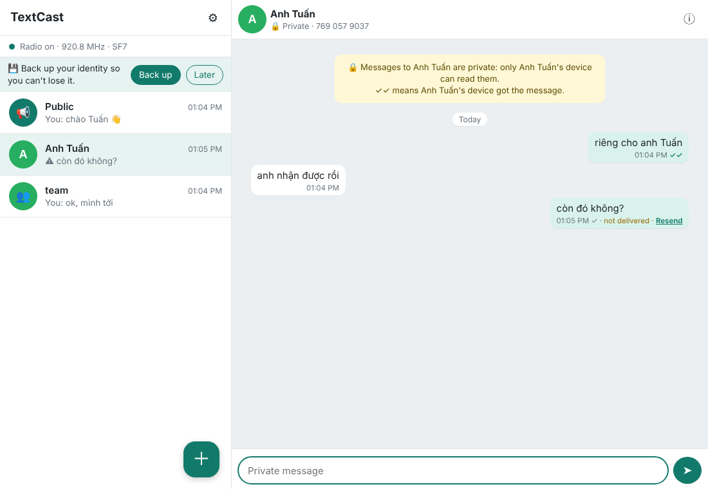
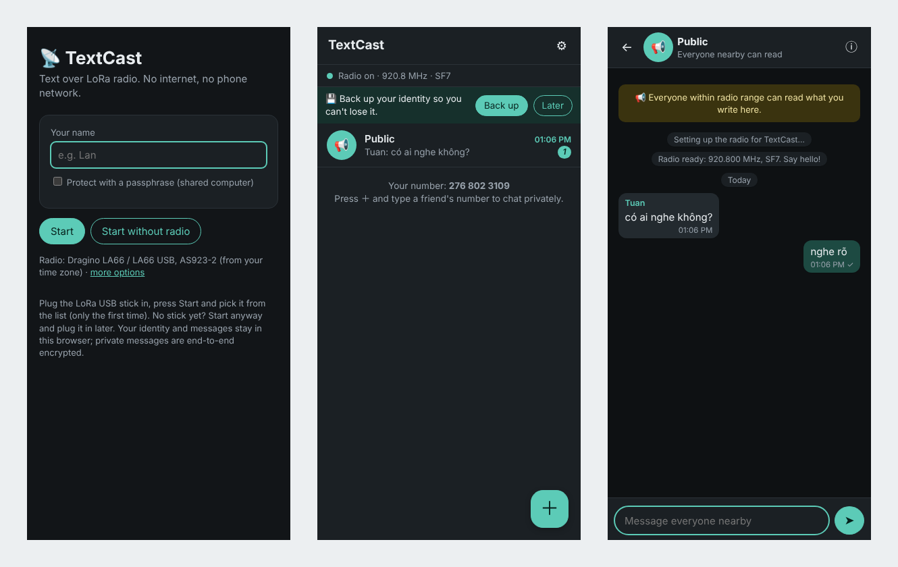
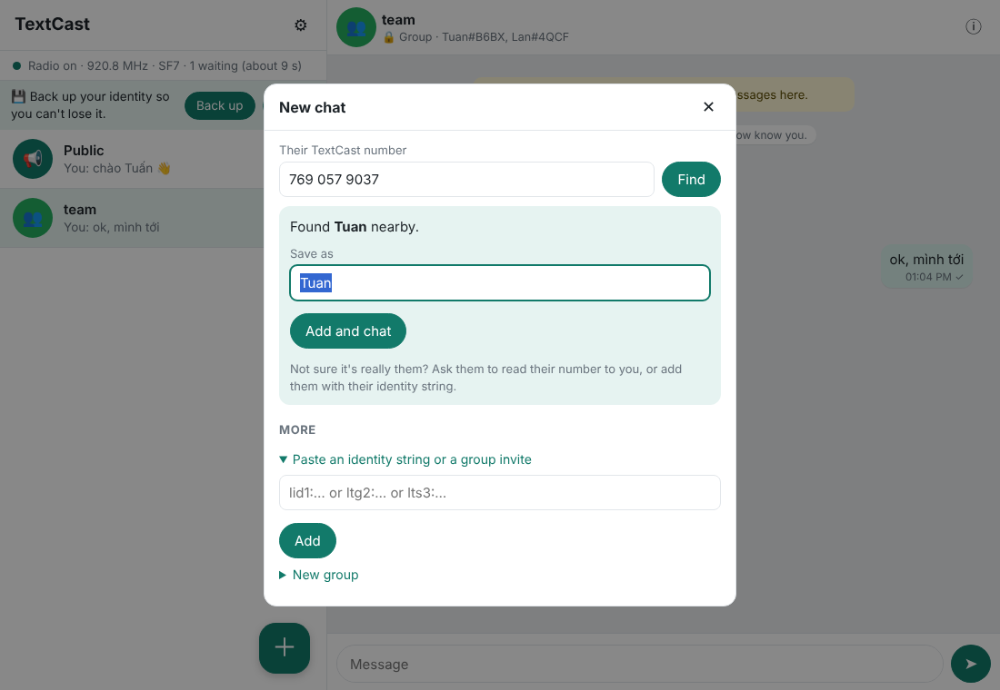
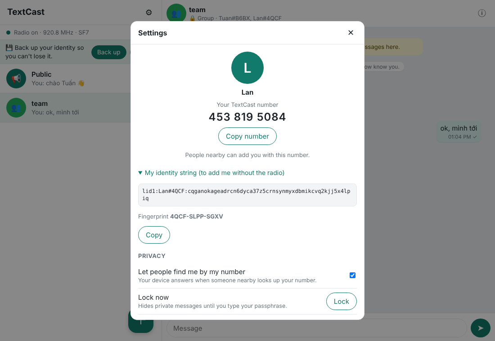

# TextCast in your browser

The easiest way to use TextCast on a computer: a web page that talks to the
LoRa USB stick directly. Nothing to install.

**Open: https://tnnotes.github.io/textcast/**

## What you need

- A computer with **Windows, macOS, Linux or ChromeOS**.
- **Chrome**, **Edge** or **Firefox 151 or newer**. (Safari and iPhones/iPads
  can't talk to USB radios. On Android phones, use the
  [Android app](ANDROID.md).)
- A LoRa USB stick: the Dragino **LA66 USB** with the P2P firmware is tested
  (see [HARDWARE.md](HARDWARE.md)).

## First start

1. Open the link above.
2. Type **your name** (1–16 characters, no spaces).
   On a shared computer, tick **Protect with a passphrase**.
3. Press **Start**, plug the stick in and pick it from the list the browser
   shows. The first time, TextCast sets the stick up (about 8 seconds).
4. Open **Public**, type a message and press Enter. Everyone in range with the
   same radio settings sees it.

No stick yet? Press **Start without radio** (or close the browser's list). You
can read and set up your chats; the bar at the top of the chat list says
**No radio**. When you plug the stick in, press **Connect** in that bar and pick
it (the browser needs this one click the first time). After that, the browser
remembers the stick: whenever it is plugged in, even after unplugging or into
another USB socket, TextCast connects by itself.

## Radio region

TextCast picks the region from the computer's time zone (Vietnam and
Indonesia: AS923-2, Europe: EU868, USA: US915, ...). **Everyone must use the
same settings.** Check or change them under **more options** on the start
screen, or in ⚙ → **Advanced → Radio settings** (frequency, spreading factor,
power, ...). The preview shows how many bytes fit in one message.

Region presets are starting points, not legal advice: check your local rules.

## Using it

It works like a phone messenger.

- **Chat list** (left, or the whole window on a small screen): 📢 **Public**
  first, then people and groups, newest first, with the last message and an
  unread count. The bar on top shows the radio: *Radio on · 920.8 MHz · SF7*,
  *No radio* or *Radio unplugged*.
- **A chat** (right, or full screen with ← back): their messages on the left
  with the sender's name (in Public and groups), yours on the right with
  🕓 waiting → ✓ sent → **✓✓ delivered** (private chats). Tap a message for its
  signal strength (dBm, SNR) and size. ⓘ shows the person's number or the
  group's invite.
- The byte counter appears when a message gets close to the limit (100 bytes
  by default; Vietnamese letters with marks use 2–3 bytes).

### Add a person by their number

1. Ask for their **TextCast number** (they find it in ⚙: e.g. `512 384 9076`).
2. Press **＋** and type it, then **Find**. TextCast asks nearby devices who has
   that number (they need TextCast open with the radio plugged in, in range).
3. *Found Tuan nearby* → choose the name to save → **Add and chat**.
4. They add you the same way. Now private messages get ✓✓ when they arrive.

A wrong digit is caught before anything is sent. If two devices answer for one
number, TextCast warns and adds no one: use their identity string instead.
Contacts added by number say so in ⓘ; contacts added with their identity
string (`lid1:…`, ＋ → *Paste*) count as verified.

### Private messages

- Only the two of you can read them. ✓✓ means their device confirmed it.
- *not delivered · Resend* after 30 s: they may be out of range, switched off,
  or haven't added you. **Resend** sends it again; they won't see it twice.

### Groups and channels

- **＋ → New group:** type a name, then send the invite string (`ltg2:…`) to the
  members in person or by another app. They paste it in **＋ → Paste**.
- ⓘ in a group shows the invite again, and **Leave group**.
- ⚙ → Advanced: broadcast channels you post to (`lts3:`), and the list of
  groups and channels.

### ⚙ Settings

- **Your TextCast number** (copy it) and your identity string.
- **Let people find me by my number** (on by default).
- **Lock** (with a passphrase): hides private chats until you unlock; private
  messages that arrive meanwhile open when you unlock.
- **Notifications** and **sound** for messages while TextCast is in the
  background. Private messages show who wrote, not what.
- **Back up my identity**, **Log out**.
- **Advanced:** radio settings, the radio log (every packet heard, with signal
  strength), "show my name with its tag in public", channels, clear history.

## Works offline, installs like an app

After the first visit, TextCast works **with no internet at all**: open the
same link and it loads from the copy saved in the browser. When you are online
it updates itself quietly; the new version is used the next time you open it.

In **Chrome** or **Edge**, press **Install app** on the start screen (or the
install icon in the address bar). TextCast gets its own icon and window, like a
normal program. In Firefox, bookmark the link; it works offline the same way.

**No internet even once?** Download [`web/index.html`](../web/index.html)
(the download button on that page) on any computer, copy it with a USB drive,
and open it in the browser. It is the whole app in one file and works fully
offline. It can't be installed as an app, and it keeps its own identity
(move it with a `.ltid` file).

## Keep your identity safe

Your identity and messages are stored **in this browser only**.

- Press **Back up** (or ⚙ → Back up my identity) and keep the `.ltid` file
  somewhere safe. It is encrypted with the passphrase you choose for it.
- The same file opens in the Android app and the terminal app, and in another
  browser (*more options* → Import a .ltid file). Your TextCast number moves
  with it. **Move, don't clone:** stop using the identity on the old device.
- Clearing *browsing history* or *cached images and files* doesn't touch
  TextCast. Clearing **cookies and site data** deletes the identity and the
  messages.
- A forgotten passphrase cannot be recovered.

## Troubleshooting

| Problem | Try |
|---|---|
| "This browser can't use a USB radio" | Use Chrome, Edge or Firefox 151+ on a computer |
| The stick isn't in the list | Unplug and replug it. On Windows, install the driver for the stick's USB chip |
| "Could not open the radio" | Another program or browser tab is using the stick: close it |
| "No radio" and nothing happens when plugged in | Press **Connect** in the bar and pick the stick |
| Nobody hears me | Same region and settings on every device (⚙ → Advanced → Radio settings) |
| "Nobody answered" when adding by number | Check the number; they need TextCast open, the radio plugged in, within range, and "find me by number" on |
| Private messages stay *not delivered* | They must add you too; clocks must agree within ±5 minutes |
| "Too long for one radio message" | Shorten it; Vietnamese marks use 2–3 bytes per letter |
| Lost the identity after clearing browser data | Import your `.ltid` backup |
