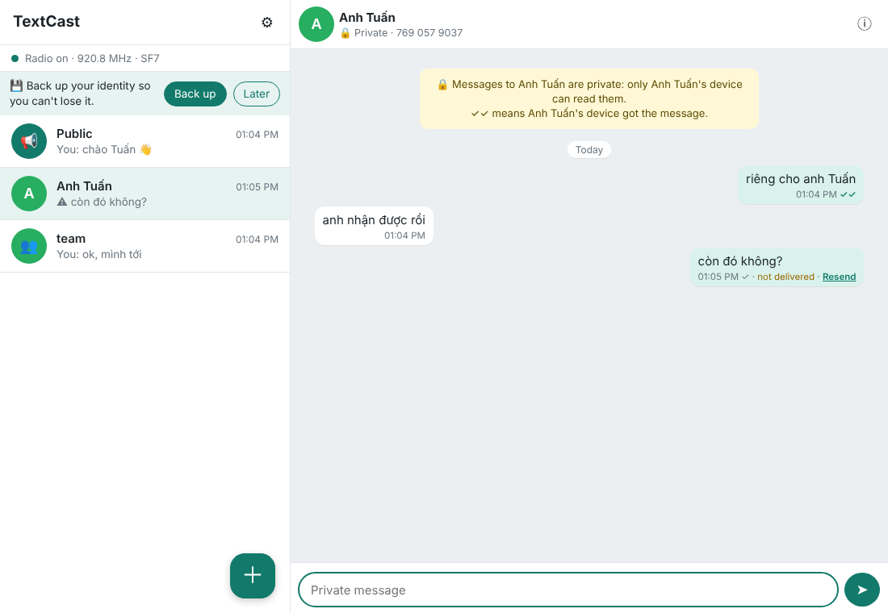
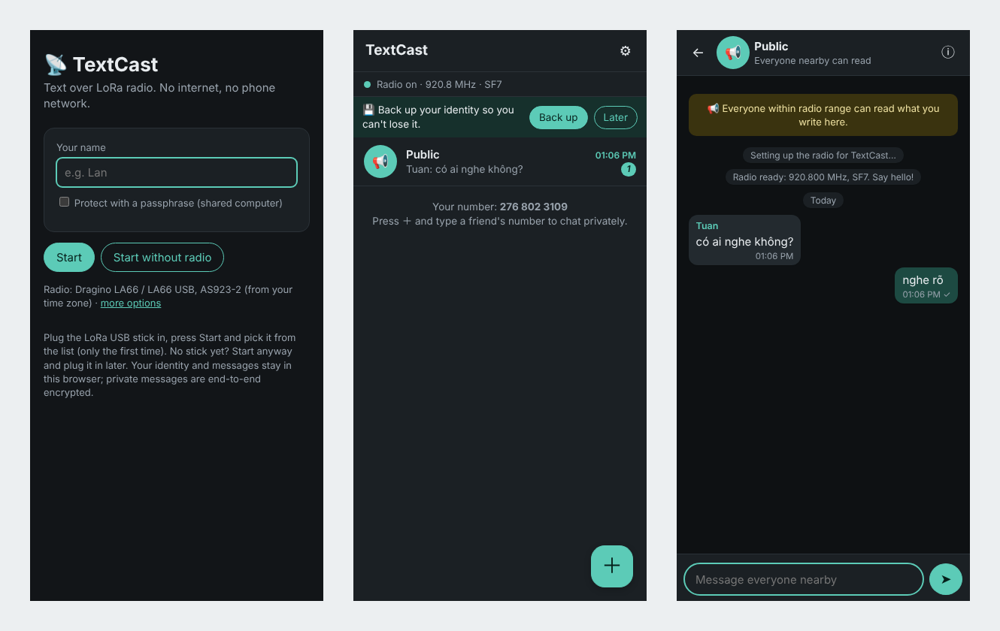
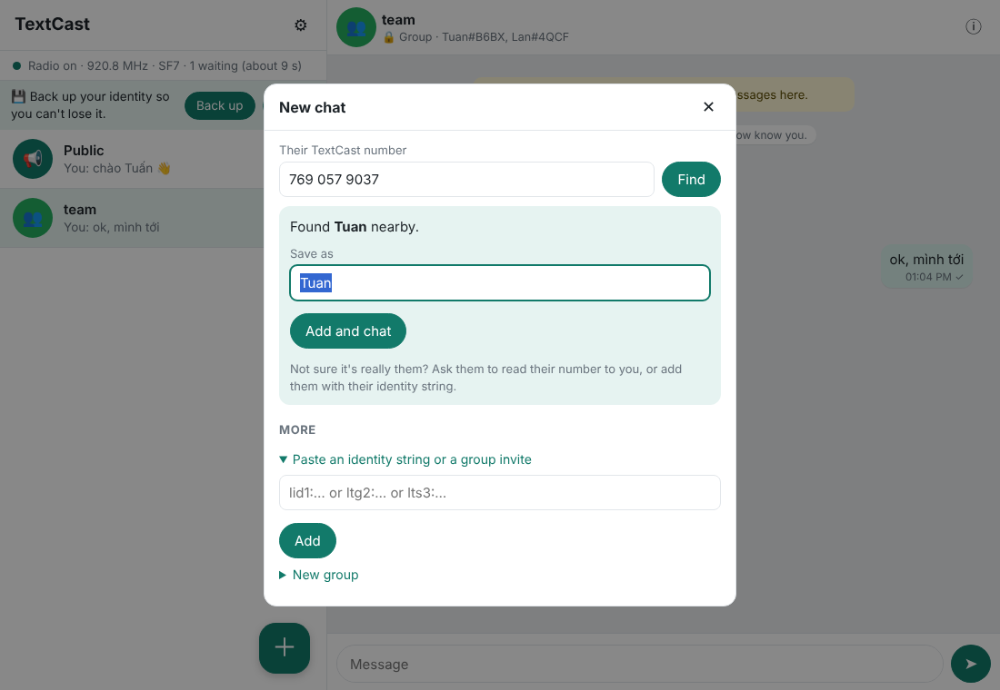

# TextCast in the browser

One web page that talks to the LoRa USB stick directly. Nothing to install:
no Python, no app, no internet.

<p align="center"></p>

```
index.html          THE app: a single self-contained file (open it, plug in, talk)
sw.js, manifest.webmanifest, icons/   offline copy and "Install" when served over https
textcast-core.js    the protocol core (built from src/; used by the tests)
src/core*.js        the core: crypto, protocol, keyring, LA66 / AT drivers, node
src/app.html        the page (the build inlines the core into index.html)
src/sw.js, src/manifest.webmanifest   templates for the files above
build.py            python3 web/build.py  ->  index.html, sw.js, manifest, textcast-core.js
tests/              compatibility tests and a browser test with a simulated LA66
```

## Use it

1. Plug the LA66 USB stick into the computer.
2. Open TextCast in **Chrome**, **Edge** or **Firefox 151+**: its web address
   (GitHub Pages), or `index.html` double-clicked from disk.
3. Type your name and press **Start**. The first time, pick the stick from the
   list the browser shows; after that the browser remembers it.
4. Talk. The first connection sets the stick up for TextCast (about 8 seconds).

No stick yet? Press Start anyway (or close the list): you can read and set up
your chats, and the bar at the top says "No radio". Plug the stick in later: a
stick you picked before connects by itself; the first time, press **Connect**
in that bar and pick it (the browser needs that one click).

It looks like a phone messenger: your chats on the left (Public first, then
people and groups with their last message and unread count), the open chat on
the right (on a phone-sized window, one at a time with ← back). Press **＋** to
add a person by their **TextCast number** (⚙ shows yours) or start a group.
⚙ → **Advanced** has the radio settings, the radio log (every packet with its
signal strength) and groups & channels.

<p align="center"></p>
<p align="center"></p>

The region comes from the computer's time zone (Vietnam and Indonesia:
AS923-2, Europe: EU868, ...); check or change it under **more options**,
where you also find the radio module, a new identity and importing a `.ltid`.

## Offline and "Install"

Opened from its web address, TextCast saves itself in the browser on the first
visit. After that it opens with no internet at all, and updates itself quietly
when there is a connection (the new version is used the next time it opens).
Chrome and Edge also offer **Install** (address bar, or the button on the start
screen): TextCast gets its own icon and window, like a normal program. Firefox
can't install it, but a bookmark works offline the same way.

`index.html` opened as a file always works offline, but can't be installed.
The web address and the file each keep their own identity and messages: move
between them with a `.ltid` export and import.

### Publish on GitHub Pages

`web/deploy/web-pages.yml` is a GitHub workflow that builds `web/` and
publishes it on every push that changes `web/`. To use it:

1. In the repository, put it at `.github/workflows/web-pages.yml`.
2. Once, on GitHub: **Settings > Pages > Source: GitHub Actions**.

The app is then at `https://<user>.github.io/<repo>/`.

Works on Windows, macOS, Linux and Chromebooks. Not on Safari or iPhone/iPad
(no Web Serial). On Android phones, use the Android app: browser USB access on
Android is only arriving with Android 17.

If Windows doesn't list the stick, it needs the driver for the stick's USB
chip.

## What it does

Everything the desktop and Android apps do, with the same protocol, so all
three chat together:

- Public messages to everyone in range; groups (encrypted) and streams (signed).
- **Private messages to one person** with delivery receipts: press ＋ and type
  their TextCast number (or paste their `lid1:` string). Your message shows
  ✓ → **✓✓** when their device confirms it, or *not delivered · Resend* after 30 s.
- Join a group, follow a channel or save a contact by pasting a `ltg2:` /
  `lts3:` / `lid1:` string (＋ → Paste); create groups (＋) and channels
  (⚙ → Advanced) and share their strings (ⓘ in the chat).
- Radio settings: region presets or manual, with a live "max bytes / airtime"
  preview; duty-cycle and dwell limits are enforced.
- Passphrase protection, lock / unlock (private messages heard while locked
  open when you unlock).
- **Export identity** to a `.ltid` file and import it here, in the desktop app
  (`identity.py`) or in the Android app. Move, don't clone.
- Notices when the stick is unplugged, and reconnects by itself when it is
  plugged back in, even into another USB socket (the bar at the top of the chat
  list shows the radio).
- In the background: unread count in the tab title, a short beep, and (if you
  allow it in ⚙) notifications. Private messages only say who wrote, not what.

## Where data is kept

In the browser's storage for that page (localStorage): the identity, settings
and the last 5000 messages. With a passphrase, the identity file is encrypted
with it (scrypt + ChaCha20, same format as `.lkey`) and the text, channel and
sender of private messages are stored encrypted. Clearing the browser's site
data deletes the identity: export a `.ltid` backup first.

Each browser (and each file location, for `file://` pages) has its own storage.

To keep them safe, TextCast asks the browser once to keep its data even when
the disk runs low, and shows a **Back up now** bar until you export a `.ltid`
file. Clearing *history* or *cached images and files* doesn't touch TextCast;
clearing *cookies and site data* deletes the identity and messages (and the
offline copy).

## Develop

```bash
python3 web/build.py                       # after editing web/src/
node --test web/tests/*.test.js                     # byte-for-byte with Python (same vectors as Android), numbers, private messages
TEXTCAST_COMPAT_OUT=web/compat/out node --test web/tests/compat.test.js
python3 android/compat/check_kotlin.py web/compat/out   # Python opens files made by the web core
python3 web/tests/e2e_browser.py --shots /tmp/shots     # headless Chrome + simulated LA66 + Python peer (also makes the screenshots)
```

The core is a port of `lora_text/` (via the Kotlin port). The crypto is plain
JavaScript (no WebCrypto), so it runs the same in the page and in Node.
The browser test needs Playwright for Python and Chrome or Chromium.
